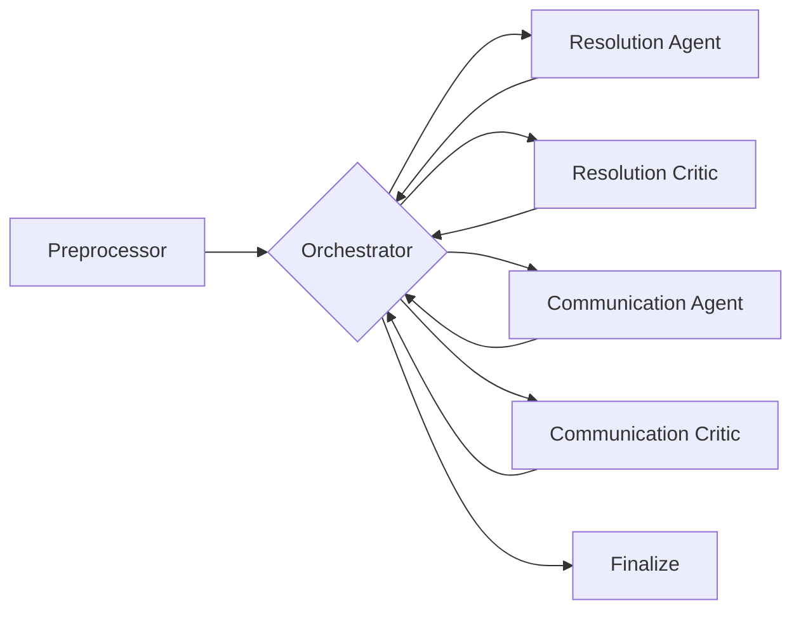

# delivery-exception-multi-agent
# Multi-Agent Delivery Exception Handling (Proof of Concept)

A LangGraph multi-agent system that triages noisy last-mile delivery logs, decides how to resolve each exception, escalates to a supervisor only when policy requires it, and drafts a personalized customer notification. Built as a course project (Agentic AI module).

## The problem
Around 10% of shipments hit an exception: a failed attempt, address problem, damaged package, refusal or weather delay. Operations staff triage these by hand, cross-checking customer profiles and a policy playbook under time pressure, which is slow and inconsistent.

## What the system does
1. Cleans raw logs: removes duplicate scans, merges multi-row shipments and filters routine events as noise.
2. Looks up customer tier and history, locker eligibility and the relevant playbook sections (RAG).
3. Decides one of four actions: `RESCHEDULE`, `REROUTE_TO_LOCKER`, `REPLACE`, `RETURN_TO_SENDER`.
4. Decides whether a supervisor must be involved.
5. Writes a customer message in the right tone (formal or casual).
6. Records an auditable trace for every decision.

## Architecture

- **Deterministic parts (plain code):** preprocessor, escalation rule engine, orchestrator and finalize step. Policy escalations cannot be overridden by an LLM.
- **LLM parts:** Resolution and Communication agents (gpt-4o-mini) with Critic agents (gpt-4o) that review them. A Critic can send a decision back for revision, up to 2 loops before forced escalation.
- **Retrieval:** the operations playbook (PDF) is chunked (800 characters, 150 overlap), embedded with `all-MiniLM-L6-v2` and stored in ChromaDB. The top 5 chunks are retrieved per query, with page numbers kept for citations.
- **Safeguards:** prompt-injection keyword guardrail on driver notes and retrieved text, and PII minimization (only the Communication Agent sees the customer name).

## Results (10 curated shipments, one run each)
| Metric | Result |
|---|---|
| Task completion | 100% |
| Escalation accuracy (8 exception cases) | 100% |
| Tool call accuracy | 100% |
| Reasoning coherence (LLM judge, 1-5) | 4.40 |
| Average latency | 4.94 s (about 6 s per exception; noise events skip the LLMs) |

## Known limitations
- Small test set (10 cases, one run each). Model outputs vary slightly between runs, so these numbers describe this run and are not a production guarantee.
- Customer message quality is the weakest area: for third-attempt locker cases the message does not say that no eligible locker is available, and some messages mention the customer's past exceptions.
- Escalation and resolution rules come from one playbook. Edge cases such as fraud-address handling are covered by prompt rules, not by test cases.

## Files
- `Project_3_Full_CODE.ipynb`: full notebook with outputs.
- `Project_3_Full_CODE.html`: exported run for viewing without Colab.

## Run it yourself
Requires an OpenAI API key and the course data files (not included). Put your credentials in a local `config.json` (never commit it) with `OPENAI_API_KEY`, `OPENAI_API_BASE`, and optional LangSmith settings. Update the file paths in the notebook, then run all cells.

## Stack
Python, LangGraph, LangChain, OpenAI, ChromaDB, sentence-transformers, Pydantic, SQLite, pandas.
